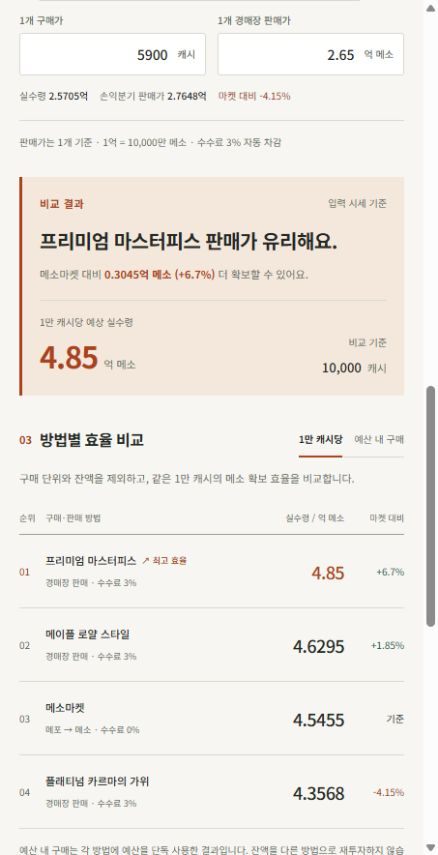
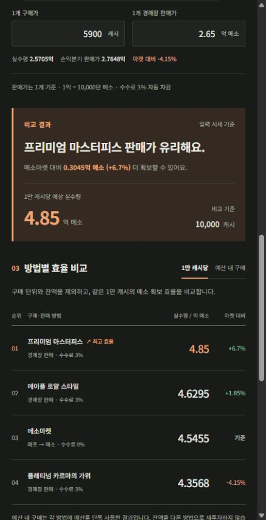

<div align="center">


# Maple MVP

**같은 캐시로 더 많은 메소를.**

메이플스토리 MVP작을 위한 캐시 아이템 판매 · 메소마켓 효율 비교 계산기

[](https://github.com/JinDevLab/maple-mvp/actions/workflows/pages.yml)
[](https://nodejs.org/)
[](src/app.js)

[**계산기 바로가기 ↗**](https://jindevlab.github.io/maple-mvp/) · [사용 방법](#사용-방법) · [로컬 실행](#로컬-실행) · [문제 제보](https://github.com/JinDevLab/maple-mvp/issues)

</div>

---

## 소개

MVP작을 할 때는 캐시 아이템의 판매가만 비교하면 실제 효율을 알기 어렵습니다. 아이템마다 구매 가격이 다르고, 경매장 수수료와 구매 후 남는 캐시도 고려해야 하기 때문입니다.

Maple MVP는 두 경로를 **같은 캐시 기준의 메소 확보량**으로 비교합니다.

```text
넥슨캐시 ─┬─ 캐시 아이템 구매 → 경매장 판매 → 수수료 3% 차감 → 메소
          └─ 메포 지급 패키지 구매 → 메소마켓에서 메소 구매 → 메소
```

내가 입력한 시세를 기준으로 유리한 경로와 손익분기 판매가를 확인할 수 있습니다. 로그인이나 별도 서버 없이 브라우저에서 동작합니다.

> **기본 가격은 사용 예시입니다.** 현재 시세를 자동으로 조회하지 않으므로, 이용 중인 게임의 실제 구매가·판매가·메소마켓 시세로 바꿔 사용하세요.

## 미리보기

라이트와 다크 모드는 같은 정보 구조를 사용합니다. 아래는 좁은 화면에서의 비교 결과입니다.

<table>
  <tr>
    <th width="50%">Light</th>
    <th width="50%">Dark</th>
  </tr>
  <tr>
    <td align="center"></td>
    <td align="center"></td>
  </tr>
</table>

## 주요 기능

| 기능 | 설명 |
| --- | --- |
| 두 가지 비교 방식 | **1만 캐시당 효율**과 **예산 내 실제 구매 결과**를 전환 |
| 아이템 목록 편집 | 이름·캐시 구매가·경매장 판매가 수정, 추가 및 삭제 — 최대 100개 |
| 수수료 자동 반영 | 경매장 판매 3%, 메소마켓 구매 0% |
| 손익분기 판매가 | 메소마켓과 같은 효율이 되는 아이템의 경매장 판매가 표시 |
| 전환 조건 설정 | 메포 지급 패키지의 가격·지급량, 메소마켓 구매 단위 변경 |
| 잔액 분리 | 사용하지 않은 캐시와 메포를 실제 수령 메소와 구분 |
| 테마 선택 | 라이트·다크·시스템 자동 모드, 선택 저장 |
| 브라우저 저장 | 입력값과 아이템 목록을 새로고침 후에도 복원 |

## 사용 방법

1. **사용할 캐시**에 전체 예산을 입력합니다. `+1만·+5만·+10만·+30만·+50만·+100만` 버튼은 누를 때마다 금액을 더합니다. **예산 0으로** 버튼으로 비울 수 있습니다.
2. **메소마켓 시세**에 1억 메소를 구매하는 데 필요한 메이플포인트를 입력합니다.
3. 필요하면 **캐시 → 메포 전환 설정**을 열어 패키지 가격, 지급 메포, 메소 구매 단위를 변경합니다.
4. 판매할 캐시 아이템의 **1개 구매가**와 **1개 경매장 판매가**를 입력합니다.
5. **메소 현금 판매 시세**에 1억 메소당 실제 수령할 원화 금액을 입력하면 현금·메소 환산 손익과 손익률이 함께 표시됩니다. 별도 판매 수수료가 있다면 차감 후 시세를 입력하세요.
6. 비교 결과에서 유리한 방법을 확인하고, **예산 내 구매**로 전환해 실제 수량과 잔액을 확인합니다.

### 입력 단위

| 입력 항목 | 단위 | 예시 |
| --- | --- | --- |
| 예산 · 아이템 구매가 · 패키지 구매가 | 캐시 | `100000` = 10만 캐시 |
| 아이템 판매가 | 억 메소 | `1.05` = 1억 500만 메소 |
| 메소마켓 시세 | 메포 / 1억 메소 | `2200` = 2,200메포로 1억 메소 구매 |
| 패키지 지급량 | 메포 | `10000` = 10,000메포 |
| 메소마켓 구매 단위 | 억 메소 | `1` = 1억 메소 단위로 구매 |

### 비교 방식의 차이

- **1만 캐시당**: 구매 단위와 잔액을 제외한 비례 계산입니다. 아이템의 순수한 교환 효율을 비교할 때 사용합니다.
- **예산 내 구매**: 아이템과 패키지를 정수 개수로 구매합니다. 메소마켓은 입력한 메소 구매 단위까지 적용하며, 남은 캐시·메포는 별도로 표시합니다.

각 방법에 예산을 **단독으로 사용한 결과**를 비교합니다. 여러 아이템을 섞거나 남은 캐시를 다른 경로에 재투자하는 최적화는 하지 않습니다.

## 계산 기준

경매장 수수료는 **3%**, 메소마켓 수수료는 **0%**로 고정합니다.

```text
아이템 개당 실수령 = 판매가 × 0.97
아이템의 1만 캐시당 메소 = 개당 실수령 ÷ 아이템 구매가 × 10,000

캐시당 지급 메포 = 패키지 지급 메포 ÷ 패키지 구매가
메포당 구매 메소 = 100,000,000 ÷ 메소마켓 시세
메소마켓의 1만 캐시당 메소 = 캐시당 지급 메포 × 메포당 구매 메소 × 10,000

손익분기 판매가 = 아이템 구매가 × 캐시당 지급 메포 × 메포당 구매 메소 ÷ 0.97
```

위 계산식의 판매가와 실수령은 **메소** 단위입니다. 화면에서는 읽기 쉽게 **억 메소**로 표시합니다.

### 계산 예시

아이템 구매가가 2,200캐시, 판매가가 1.05억 메소이고, 메포 전환 비율이 1:1, 메소마켓 시세가 1억당 2,200메포라면:

| 비교 항목 | 아이템 판매 | 메소마켓 |
| --- | ---: | ---: |
| 1만 캐시당 메소 | 약 4.6295억 | 약 4.5455억 |
| 10만 캐시 예산의 구매 수량 | 아이템 45개 | 1만 캐시 패키지 10개 → 1억 메소 단위 45회분 |
| 예산 내 실제 수령 | 45.8325억 | 45억 |
| 남은 재화 | 1,000캐시 | 1,000메포 |

이 예시의 **1만 캐시당 효율**은 아이템 판매가 메소마켓보다 **1.85%** 높습니다. 예산 내 구매는 정수 수량과 잔액 때문에 비례 계산과 결과가 달라질 수 있습니다.

### 적용 범위

- 1캐시 = 1원으로 간주하며, 할인 충전·마일리지·MVP 보상·크레딧 가치는 포함하지 않습니다.
- MVP 등급과 실적 인정 여부는 자동 판정하지 않습니다. 충전만으로 실적이 쌓인다고 가정하지 않습니다.
- 거래 가능 여부, 상품 구매 한도, 판매 성사 여부와 실제 호가는 게임에서 확인해야 합니다.
- 거래별 1메소 미만의 수수료 처리 차이는 반영하지 않습니다.
- 현금 손익은 입력한 시세에 따른 예상치입니다. 미판매 메포의 잔여 가치는 현금 수익으로 포함하지 않으며, 패키지 구매 비용은 전액 포함합니다.

## 현금 판매 손익

현금 시세는 자동 수집하지 않으며 기본값은 비어 있습니다. 입력 전에도 메소 비교는 사용할 수 있습니다.

```text
예상 판매대금(원) = 수령 메소 ÷ 100,000,000 × 현금 시세(원/억)
손익(원) = 예상 판매대금 − 비용
손익률(%) = 손익 ÷ 비용 × 100
손익의 메소 환산 = 손익(원) ÷ 현금 시세 × 100,000,000
```

1만 캐시당 모드의 비용은 10,000원, 예산 내 구매 모드의 비용은 **실제 사용 캐시**입니다(1캐시=1원). 비용이 0이면 손익률은 표시하지 않습니다. 사용하지 않은 캐시는 지출로 잡지 않고, 남은 메포는 매각하지 않은 재화로 별도 표시합니다. 패키지 비용은 전액 지출로 잡으므로 잔여 메포가 클수록 현금 회수 기준 손실이 커질 수 있습니다.

예를 들어 10,000캐시를 사용해 5억 메소를 얻고 현금 판매 시세가 1억당 1,800원이라면, 판매대금은 9,000원, 손익은 **−1,000원 / −10% / 약 −0.5556억 메소**입니다. 메소 손익은 추가 거래 손실이 아니라 같은 원화 손익을 메소로 표현한 값입니다.

방법별 **메소마켓 대비 차이**와 **실제 지출 대비 현금 손익**은 다른 지표입니다. 표의 마켓 대비 항목은 메소와 원화로, 현금 손익은 원화·메소 환산·백분율로 구분합니다.

### 기본 아이템 프리셋

| 아이템 | 구매가(캐시) | 판매가(억 메소) |
| --- | ---: | ---: |
| 메이플 로얄 스타일 | 2,200 | 1.15 |
| 프리미엄 마스터피스 | 1,900 | 0.9 |
| 플래티넘 카르마의 가위 | 5,900 | 3.14 |
| 컬러링 프리즘 프로 | 25,000 | 12.6 |
| 부티크 기프트 | 33,000 | 17.3 |
| 원더베리 | 54,000 | 28 |
| 루나 크리스탈 | 3,900 | 2 |

사용자가 제공한 예시 가격이며 실시간 시세가 아닙니다. 새 방문 및 **기본 프리셋으로 초기화** 시 적용됩니다. 기존 브라우저에 저장된 개인 아이템 목록은 보존합니다.

## 로컬 실행

**Node.js 22 이상**이 필요합니다. 외부 npm 의존성이 없으므로 `npm install` 없이 실행할 수 있습니다.

```sh
git clone https://github.com/JinDevLab/maple-mvp.git
cd maple-mvp
npm run dev
```

브라우저에서 [http://127.0.0.1:4173/maple-mvp/](http://127.0.0.1:4173/maple-mvp/)를 엽니다. ES modules를 사용하므로 HTML 파일을 직접 열기보다 개발 서버를 사용하세요.

| 명령 | 동작 |
| --- | --- |
| `npm run dev` | 로컬 정적 서버 실행 — 기본 포트 `4173` |
| `npm test` | Node.js 내장 테스트 러너로 계산 검증 |
| `npm run build` | 배포할 정적 파일을 `dist/`에 생성 |

테스트는 수수료와 환율, 정수 수량과 잔액, 손익분기 동률, 0·잘못된 입력, 저장 데이터 복구 등을 검증합니다. UI를 변경했다면 브라우저에서 테마 전환, 모바일 배치, 아이템 편집도 함께 확인하세요.

## 프로젝트 구조

```text
maple-mvp/
├── .github/workflows/pages.yml  # 검증 및 GitHub Pages 배포
├── docs/images/                # README 미리보기
├── scripts/
│   ├── build.mjs               # 정적 배포 파일 생성
│   └── serve.mjs               # 로컬 미리보기 서버
├── src/
│   ├── app.js                  # 입력 처리와 비교표 렌더링
│   ├── calculate.js            # 계산, 입력 검증, 저장값 복구
│   ├── styles.css              # 반응형 배치와 테마 색상
│   └── theme.js                # 첫 화면 테마 적용 및 선택 저장
├── test/calculate.test.js      # 계산 테스트
├── DESIGN.md                   # 프런트엔드 디자인 원칙
├── index.html
└── package.json
```

**HTML · CSS · JavaScript**만으로 구현합니다. 계산 로직은 DOM 코드와 분리되어 브라우저와 테스트에서 동일하게 사용됩니다. 외부 폰트와 프런트엔드 프레임워크는 사용하지 않습니다.

입력값은 `localStorage`의 `maple-mvp:v1`, 테마는 `maple-mvp:theme`에 저장됩니다. 별도 서버로 전송하지 않으며, 브라우저나 사이트 주소가 달라지면 저장값이 공유되지 않습니다. 사이트 데이터를 삭제하면 저장값도 사라집니다.

## 배포

서비스 주소: **https://jindevlab.github.io/maple-mvp/**

[GitHub Actions 워크플로](.github/workflows/pages.yml)가 다음 순서로 실행됩니다.

```text
main push → 계산 테스트 → 정적 빌드 → Pages 아티팩트 업로드 → 배포
```

`main` 대상 Pull Request에서는 테스트와 빌드만 수행합니다. 배포는 `main`에서만 실행되며, Actions 화면에서 수동 실행할 수도 있습니다.

포크에서 배포하려면 저장소의 **Settings → Pages → Source**를 **GitHub Actions**로 지정하세요. 정적 파일은 상대 경로를 사용하므로 프로젝트 하위 경로에서도 동작합니다.

## 피드백 및 기여

계산이 예상과 다르면 [이슈](https://github.com/JinDevLab/maple-mvp/issues)에 **입력한 시세·예산, 비교 모드, 예상 결과와 실제 결과**를 함께 남겨 주세요. 화면 문제에는 브라우저와 화면 크기를 첨부하면 도움이 됩니다.

디자인 변경은 [DESIGN.md](DESIGN.md)를 기준으로 라이트·다크 모드와 좁은 화면을 함께 확인합니다. 계산 변경은 관련 테스트를 추가하거나 수정한 뒤 `npm test`와 `npm run build`로 검증합니다.

## 참고 자료

게임 메커니즘은 아래 공식 가이드를 참고했습니다. 자료 확인일은 **2026-10-24**이며, 실제 게임 내 상품 안내와 적용 조건을 우선합니다.

- [메이플스토리 MVP 시스템](https://maplestory.nexon.com/Guide/N23GameInformation/Articles/425)
- [메이플스토리 캐시샵 이용 안내](https://maplestory.nexon.com/guide/n23gameinformation/articles/424)
- [메이플스토리 메소마켓 가이드 검색](https://maplestory.nexon.com/Guide/N23GameInformation/Articles/Search?keyword=%EB%A9%94%EC%86%8C%EB%A7%88%EC%BC%93)

---

메이플스토리 비공식 팬 도구입니다. Nexon 및 메이플스토리의 공식 서비스가 아닙니다.
